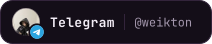
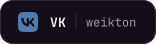
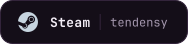

<picture>
  <source media="(prefers-color-scheme: dark)" srcset="https://raw.githubusercontent.com/isweikton/isweikton/main/assets/banner-dark.svg" />
  <source media="(prefers-color-scheme: light)" srcset="https://raw.githubusercontent.com/isweikton/isweikton/main/assets/banner-light.svg" />
  
</picture>

  <a href="https://t.me/weikton"><picture>
    <source media="(prefers-color-scheme: dark)" srcset="https://raw.githubusercontent.com/isweikton/isweikton/main/assets/link-telegram-dark.svg" />
    <source media="(prefers-color-scheme: light)" srcset="https://raw.githubusercontent.com/isweikton/isweikton/main/assets/link-telegram-light.svg" />
    
  </picture></a>
  <a href="https://vk.com/weikton"><picture>
    <source media="(prefers-color-scheme: dark)" srcset="https://raw.githubusercontent.com/isweikton/isweikton/main/assets/link-vk-dark.svg" />
    <source media="(prefers-color-scheme: light)" srcset="https://raw.githubusercontent.com/isweikton/isweikton/main/assets/link-vk-light.svg" />
    
  </picture></a>
  <a href="https://steamcommunity.com/id/tendensy/"><picture>
    <source media="(prefers-color-scheme: dark)" srcset="https://raw.githubusercontent.com/isweikton/isweikton/main/assets/link-steam-dark.svg" />
    <source media="(prefers-color-scheme: light)" srcset="https://raw.githubusercontent.com/isweikton/isweikton/main/assets/link-steam-light.svg" />
    
  </picture></a>

<picture>
  <source media="(prefers-color-scheme: dark)" srcset="https://raw.githubusercontent.com/isweikton/isweikton/main/assets/divider-dark.svg" />
  <source media="(prefers-color-scheme: light)" srcset="https://raw.githubusercontent.com/isweikton/isweikton/main/assets/divider-light.svg" />
  
</picture>

<picture>
  <source media="(prefers-color-scheme: dark)" srcset="https://raw.githubusercontent.com/isweikton/isweikton/main/assets/whoami-dark.svg" />
  <source media="(prefers-color-scheme: light)" srcset="https://raw.githubusercontent.com/isweikton/isweikton/main/assets/whoami-light.svg" />
  
</picture>

<picture>
  <source media="(prefers-color-scheme: dark)" srcset="https://raw.githubusercontent.com/isweikton/isweikton/main/assets/stack-dark.svg" />
  <source media="(prefers-color-scheme: light)" srcset="https://raw.githubusercontent.com/isweikton/isweikton/main/assets/stack-light.svg" />
  
</picture>

<picture>
  <source media="(prefers-color-scheme: dark)" srcset="https://raw.githubusercontent.com/isweikton/isweikton/main/assets/devices-dark.svg" />
  <source media="(prefers-color-scheme: light)" srcset="https://raw.githubusercontent.com/isweikton/isweikton/main/assets/devices-light.svg" />
  
</picture>

<picture>
  <source media="(prefers-color-scheme: dark)" srcset="https://raw.githubusercontent.com/isweikton/isweikton/main/assets/workstation-dark.svg" />
  <source media="(prefers-color-scheme: light)" srcset="https://raw.githubusercontent.com/isweikton/isweikton/main/assets/workstation-light.svg" />
  
</picture>

<picture>
  <source media="(prefers-color-scheme: dark)" srcset="https://raw.githubusercontent.com/isweikton/isweikton/main/assets/divider-dark.svg" />
  <source media="(prefers-color-scheme: light)" srcset="https://raw.githubusercontent.com/isweikton/isweikton/main/assets/divider-light.svg" />
  
</picture>

  <a href="https://github.com/isweikton?tab=followers"><picture>
    <source media="(prefers-color-scheme: dark)" srcset="https://img.shields.io/github/followers/isweikton?style=flat-square&label=followers&labelColor=120C15&color=2A1D31&logo=github&logoColor=D48BEA" />
    <source media="(prefers-color-scheme: light)" srcset="https://img.shields.io/github/followers/isweikton?style=flat-square&label=followers&labelColor=F3ECF6&color=E6D6EE&logo=github&logoColor=8E3DB0" />
    
  </picture></a>
  <picture>
    <source media="(prefers-color-scheme: dark)" srcset="https://visitor-badge.laobi.icu/badge?page_id=isweikton.isweikton&left_color=%23120C15&right_color=%236E3A85&left_text=visitors" />
    <source media="(prefers-color-scheme: light)" srcset="https://visitor-badge.laobi.icu/badge?page_id=isweikton.isweikton&left_color=%236B5C75&right_color=%239440B6&left_text=visitors" />
    
  </picture>

