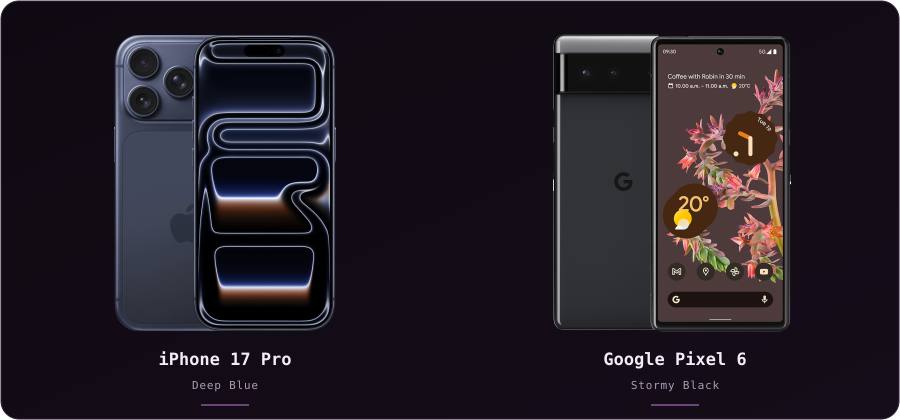

  
  
  
  

<h3><code>&nbsp;// stack&nbsp;</code></h3>

  
  
  
  
  
  

  
  
  
  
  
  

  
  
  
  
  
  

<h3><code>&nbsp;// whoami&nbsp;</code></h3>

<h3><code>&nbsp;// devices&nbsp;</code></h3>

<h3><code>&nbsp;// workstation&nbsp;</code></h3>

<table width="92%">
  <tr><th align="left"><code>GPU</code></th><td>NVIDIA GeForce RTX 4060 Ti</td></tr>
  <tr><th align="left"><code>CPU</code></th><td>Intel Core i5-12400F</td></tr>
  <tr><th align="left"><code>OS</code></th><td>Windows 11 Home Single Language</td></tr>
  <tr><th align="left"><code>RAM</code></th><td>16 GB</td></tr>
</table>

<h3><code>&nbsp;// telemetry&nbsp;</code></h3>

  

